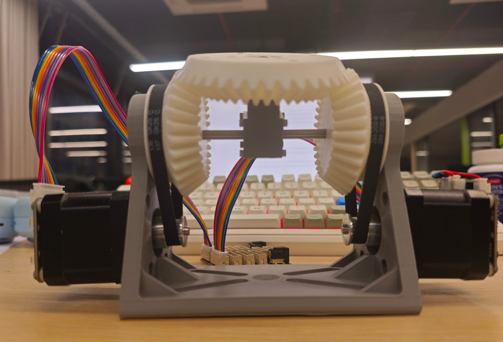
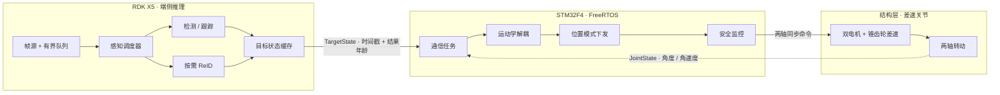
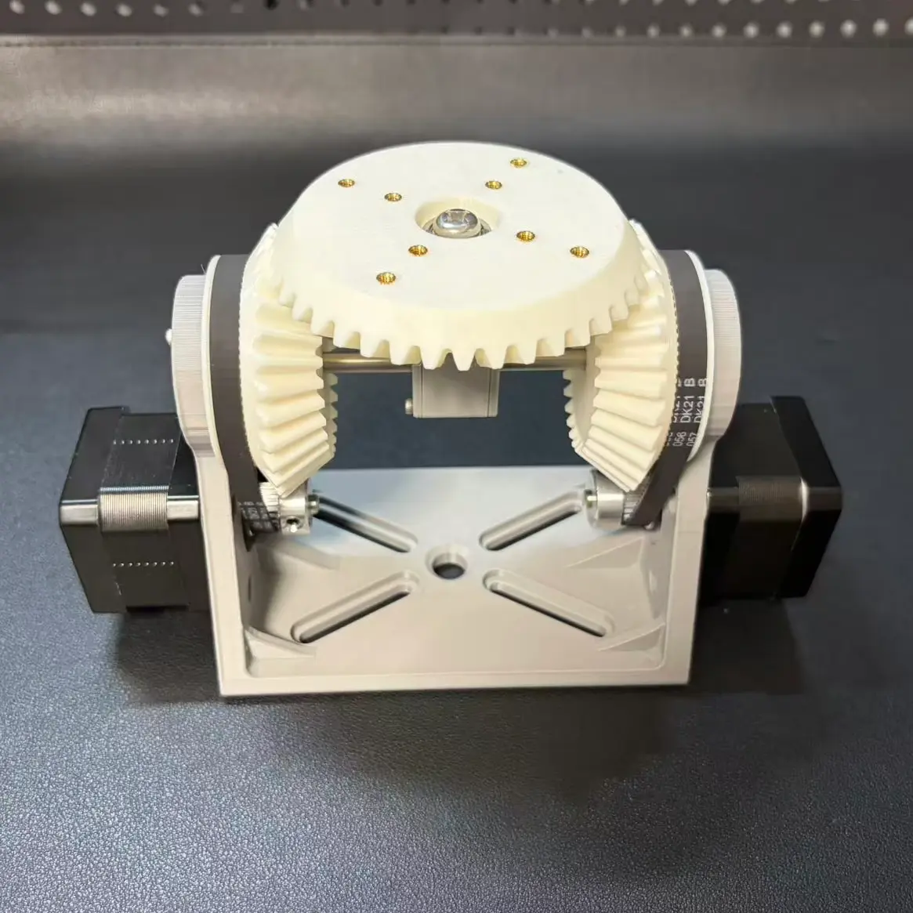
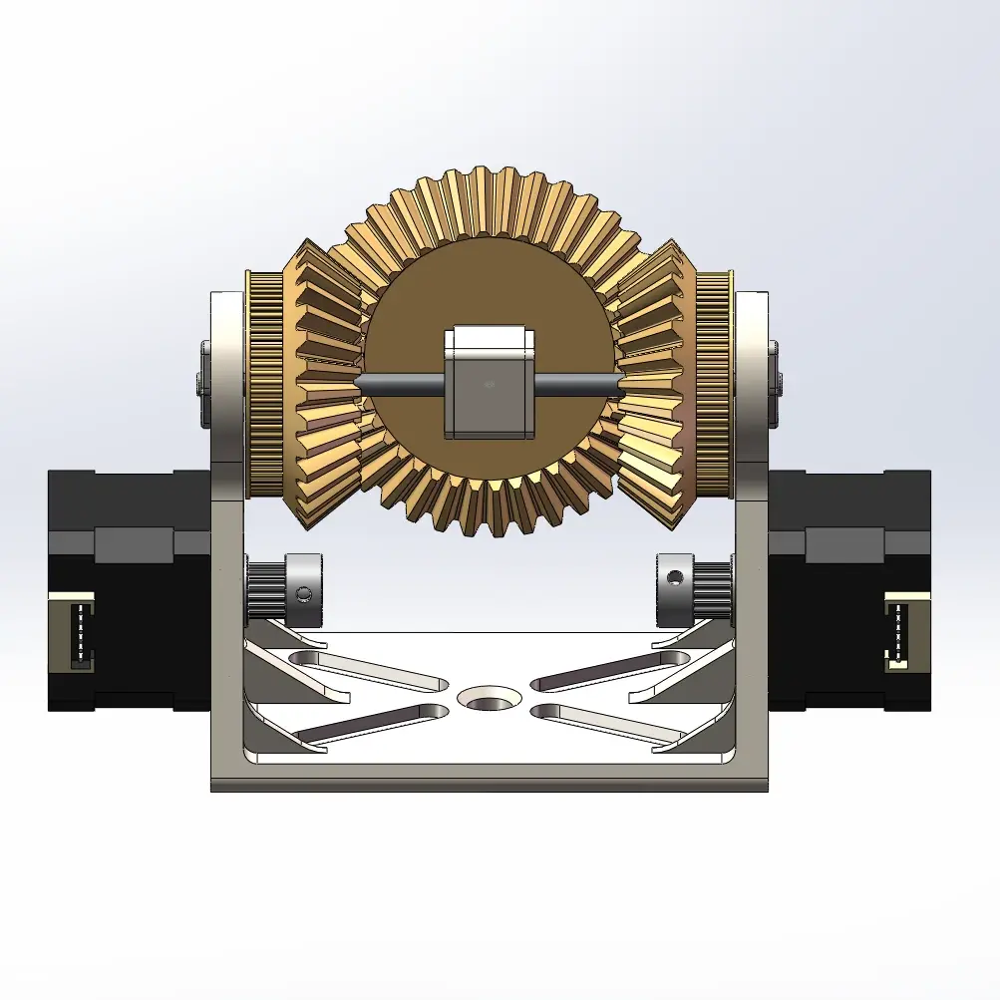

# EdgeGaze

**双自由度差速视觉关节 · 端侧按需感知**




*两台 42 闭环步进经锥齿轮差速驱动顶部平台；相机装在上面，盯住用户点选的那个人。*

> 机械已装配。已落地帧源/有界队列（rdk-01）与人体检测基线（rdk-02），推理运行时仍在推进。

## 系统结构



三层的接口按时间戳对齐：帧时间戳、关节状态时间戳、结果年龄与控制 deadline。

## 硬件

| 实拍细节 | CAD 正视图 |
| --- | --- |
|  |  |

| 项目 | 参数 |
| --- | --- |
| 电机 | 2 × 42 闭环步进（Emm_V5），UART 115200 多机总线 |
| 传动 | 侧面两个 30 齿锥齿轮 + 76 齿同步轮，顶部 40 齿锥齿轮 |
| 尺寸 | 云台面水平朝上时距底约 118 mm；基座 120 × 78 mm（不含电机） |
| 驱动板 | ZDT_MCE_V1.0 无源并联扩展板，10 路 XH2.54-8P，无 MCU、无保险丝 |
| 控制 | STM32F407 + FreeRTOS，USART1 921600 → RDK，USART2 115200 → 电机总线 |
| 上位 | RDK X5，Ubuntu 22.04 aarch64、BPU |

## 快速开始

当前提供可构建的 X5 帧源、有界队列与人体检测基线；RDK X5 上可用 OpenCV 构建视频回放与摄像头帧源，检测程序需额外开启 BPU 后端。测试按仓库规则记录后移除。

```bash
# 主机：无 OpenCV，仅编译库（帧源需 OpenCV 才能打开）
cmake -S vision -B build-vision -DEDGEGAZE_WITH_OPENCV=OFF
cmake --build build-vision -j

# 板端（RDK X5，aarch64）：带 OpenCV 与 BPU 的视频回放/摄像头帧源与检测基线
cd /userdata/edgegaze && cmake -S vision -B build-vision -DCMAKE_BUILD_TYPE=Release -DEDGEGAZE_WITH_OPENCV=ON -DEDGEGAZE_WITH_BPU=ON
cmake --build build-vision -j
./build-vision/edgegaze_detect_video --video testdata/vtest.mp4 \
  --model /opt/tros/humble/lib/mono2d_body_detection/config/multitask_body_head_face_hand_kps_960x544.hbm \
  --fps 10 --queue-capacity 900 --out-dir results
```

| 位置 | 环境 | 说明 |
| --- | --- | --- |
| RDK X5 | Ubuntu 22.04 aarch64、BPU | 构建与运行都在板端 |
| STM32F407 | arm-none-eabi-gcc 或 Keil MDK | 烧录走 ST-Link |
| 主机 | Windows + 可选 WSL | 编辑、同步、离线分析 |

运行时直接调 V4L2 与 BPU。官方示例只作基线对照，不进入本项目依赖。

## 目录

```text
edgegaze/
├── assets/       图片
├── firmware/     STM32F4 + FreeRTOS
│   ├── app/          任务与状态机
│   ├── bsp/          时钟、GPIO、UART / CAN
│   ├── drivers/      Emm_V5 驱动器与电机总线
│   ├── rtos/         FreeRTOS 配置与任务入口
│   ├── protocol/     TargetState / JointState 编解码
│   └── tests/        单测与故障注入
├── vision/       RDK X5 端侧推理
│   ├── runtime/      帧源、有界队列、会话池、结果缓存
│   ├── detector/     人体检测基线（rdk-02）
│   ├── apps/         可执行程序（视频回放检测）
│   ├── scheduler/    优先级、deadline、按需触发
│   ├── models/       模型转换、量化、模型卡
│   ├── tracker/      跟踪与目标状态
│   ├── reid/         特征缓存与匹配
│   └── bridge/       协议桥
├── hardware/     结构参数、装配与标定脚本
├── bench/        场景、采集与统计脚本
└── tools/        构建、模型转换、分析辅助
```

## 路线图

| 里程碑 | 内容 | 状态 |
| --- | --- | --- |
| M1 结构标定 | 方向、零点、耦合矩阵、回差、轴间耦合 | 未开始 |
| M2 固件 | 电机总线、FreeRTOS 任务、位置伺服与安全 | 未开始 |
| M3 推理运行时 | 帧源、检测、跟踪、按需 ReID、三模式调度 | 进行中（帧源/有界队列、检测基线已落地） |
| M4 拼接 | 协议统一、时间同步、跨层年龄策略 | 未开始 |
| M5 评测 | 固定场景集、质量—成本曲线、demo | 未开始 |

## 参考

- [RDK X5 官方文档](https://developer.d-robotics.cc/)
- [D-Robotics 模型与示例](https://github.com/D-Robotics)
- Emm_V5 闭环步进驱动说明书（厂商 PDF，随硬件提供）

## License

待定。